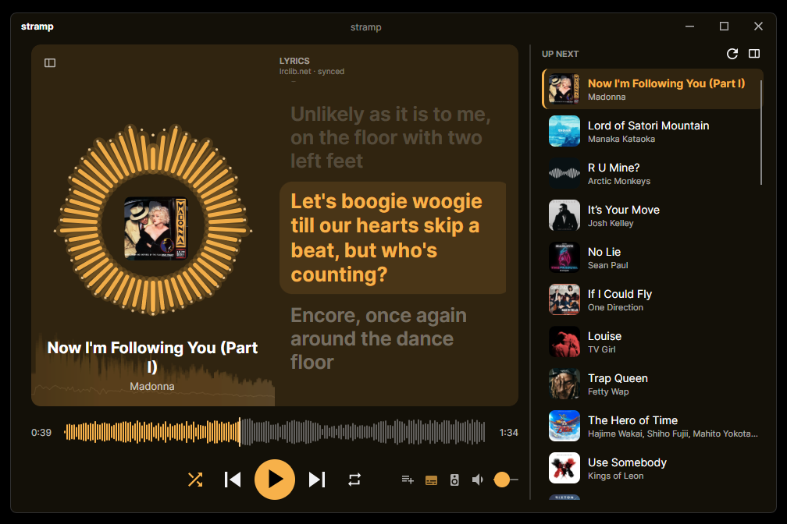
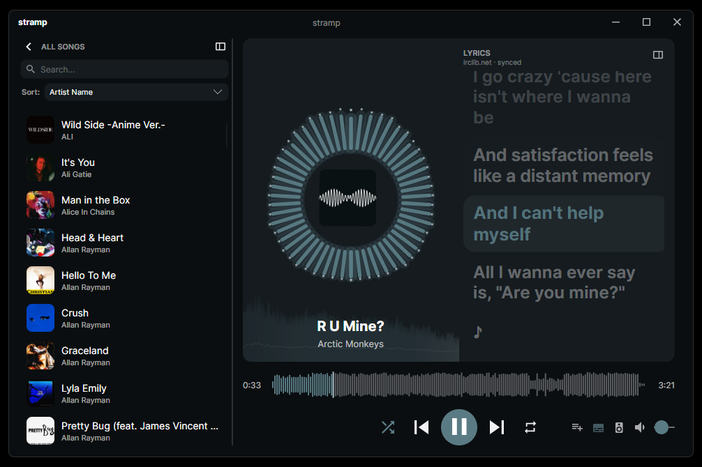

## Overview:

**str-amp** is a local library music player, designed for those who like to own their data. 

Written in C#, with an Avalonia UI backend, lighter than Spotify, open source, free forever.

## Features:

**str-amp** currently supports a set of features including but not limited to:

- Multiple track sources
- Up to 5.1 surround sound
- `.m3u8` playlist support (creating and using)
- Audio normalization and a built in EQ
- 5 (*optional*) standardized audio enhancements (clarity, ambience, surround, dyn boost, and bass boost)
- Automatic lyric retrieval through LRCLIB integration, with support for the full .lrc format when enabled
- Auto theming based on each songs album art
- Discord integration
- Listening stats (all time and month by month)
- Optimizations to allow for libraries with tens of thousands of songs
- A truly random seed-based shuffle algorithm to allow for seamless re-opening (you end up where you left off.)
- Media keys support
- Taskbar hover controls
- Waveform progress bar support (inspired by [playback-waveform-bar](https://github.com/Konsl/spicetify-extensions/tree/main/playback-bar-waveform) by Konsl)

 

---

### Requirements:

**[ffmpeg](https://ffmpeg.org/download.html)** on your `PATH` is needed for `.ogg` / `.opus` playback, audio normalization, and the waveform. Everything else plays without it.

**Linux** (x64, glibc 2.28+): download the `linux-x64` `.tar.gz`, extract it anywhere and run `Stramp.App`. It needs **ffmpeg** (it decodes everything there) and **PulseAudio or PipeWire**. Media keys and the desktop media widget work through MPRIS, and Discord Rich Presence works too. "Application menu shortcut" in settings adds a launcher entry.

### Disclaimer:

**str-amp** will never share any usage data with anybody, and it only ever needs network access to check for updates / ask to install them for you.

**str-amp** was developed in-part with **Claude** by **Anthropic**, both contributors are real developers, and we *do not* use AI as a substitute for our better judgement.

---

### Credits:
**[Dylan Strong]()**: Programming, UI, Art/Graphics, Avalonia rewrite.

**[Aiden Adzich]()**: Programming, UI, Avalonia rewrite. 

---
